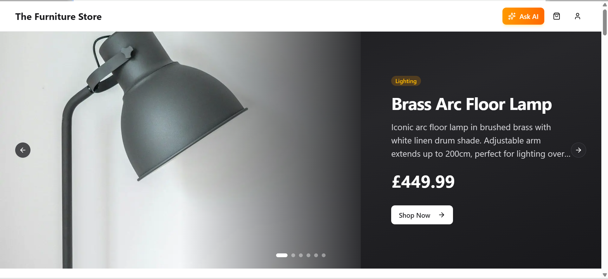

# 🛋️ AI E-commerce Platform

A full-stack furniture store with an AI shopping assistant, live inventory and an admin dashboard. Built with Next.js, TypeScript, Sanity, Clerk and Stripe.



🔗 **Live demo:** [ai-ecommerce-platform-three.vercel.app](https://ai-ecommerce-platform-three.vercel.app/)

## ✨ Features

**Shoppers**
- Browse and search furniture by category, material, colour and price
- Chat with an AI assistant that finds products and checks order status
- Persistent shopping cart with stock validation
- Secure checkout with Stripe
- Order history for signed-in users

**Admins**
- Dashboard with sales and inventory insights
- Create, edit and publish products
- Update order status (paid, shipped, delivered)
- Low-stock alerts

## 🛠️ Tech Stack


- **Frontend:** Next.js (App Router), React, TypeScript, Tailwind CSS, shadcn/ui
- **Content and data:** Sanity CMS
- **Authentication:** Clerk
- **Payments:** Stripe Checkout and webhooks
- **AI:** Vercel AI SDK with Claude
- **State:** Zustand
- **Hosting:** Vercel

## 🚀 Run It Locally

```bash
git clone https://github.com/mosesyogo/YOUR-REPO-NAME.git
cd YOUR-REPO-NAME
pnpm install
cp .env.example .env.local
pnpm dev
```

Open [http://localhost:3000](http://localhost:3000).

### Environment variables

Add your own values to `.env.local` (never commit this file):

```
NEXT_PUBLIC_SANITY_PROJECT_ID=
NEXT_PUBLIC_SANITY_DATASET=
SANITY_API_WRITE_TOKEN=
NEXT_PUBLIC_CLERK_PUBLISHABLE_KEY=
CLERK_SECRET_KEY=
STRIPE_SECRET_KEY=
STRIPE_WEBHOOK_SECRET=
AI_GATEWAY_API_KEY=
```

## 🧠 What I Practised

- Building a full-stack app with the Next.js App Router
- Connecting authentication, a CMS and payments in one project
- Giving an AI assistant tools that respect who is signed in
- Handling Stripe webhooks to create orders and update stock
- Deploying and configuring a project on Vercel

## 👤 Author

**Moses Yogo**, Front-End Developer
[LinkedIn](https://www.linkedin.com/in/moses-yogo) · [GitHub](https://github.com/mosesyogo)